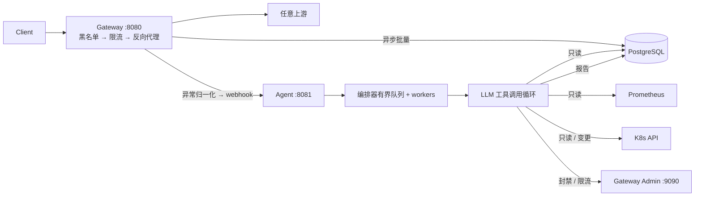

# Halon 项目阅读指南(How to Read This Project)

> 写给第一次接手本项目的人。目标:用最少的时间建立**正确的**理解,而不是通读每一行代码。
> 主线代码读懂约需 2 小时;加上动手实验约半天。

## 核心原则:先建立"地图",再看"细节"

不要从代码开始读,**从请求的生命周期开始读**。理解一个系统最快的路径是回答:
"一个请求进来,到出结果,中间经过了谁、变成了什么、失败时会发生什么?"

---

## 0. 一句话理解

**一个"会自己排查故障"的 K8s 网关。** 网关转发请求与运行弹性策略时若捕捉到上游超时(504)、连接失败(502)、熔断跳闸(503)、5xx/并发/限流突增等异常,经归一化后把事件推给 Agent;Agent 按事件类型匹配排查画像并驱动大模型调用工具(查流量日志库、Prometheus、网关运行态、K8s)排查,产出中文 Markdown 报告落库。



## 1. 先记住三个关键概念

读代码之前先把这三点装进脑子,后面很多"为什么这么写"都能自己解释:

1. **唯一契约 `incident.Event`**([internal/incident/event.go](../internal/incident/event.go)):网关(发送方)与 Agent(接收方)只通过这个结构体耦合,支持 `EventType`、`ScopeKey` 与扩展 `Details`,后续接入新触发源直接复用同一契约。网关不感知任何具体业务服务。
2. **操作级别**:`readonly` < `operator`(重启 Pod / 扩缩容 / 封禁 / 限流)< `full`(改镜像)。默认 `readonly`;`Registry` 在注册时按级别过滤工具,执行时再校验一次。
3. **职责边界与状态分层**:网关是无状态可扩展数据面,`REDIS_URL` 为网关必填项,承载黑名单、限流与跨副本按 `(event_type, scope_key)` 异常归一化、突增阈值判定及发件冷却;熔断器/并发舱壁**有意保持 per-replica**。Agent 是单实例控制面(不依赖 Redis),以独立 Session 执行排查并在进程内通过资源锁与冷却防止并发 Session 竞争;事件去重由数据库主键 `INSERT … ON CONFLICT DO NOTHING` 表决,启动时自动回收未完成行。Agent 可通过只读工具调用网关 `/admin/state/*` 查阅 Redis 与运行态。

## 2. 阅读路径(按顺序执行)

### 第 1 步:读文档,不看代码(约 30~60 分钟)

1. 根目录 [AGENTS.md](../AGENTS.md):约定与「当前已知边界」。
2. 两个核心模块文档:[modules/gateway.md](modules/gateway.md)、[modules/agent.md](modules/agent.md)。
3. 可选:[system-architecture.txt](system-architecture.txt) 了解立项动机——它是历史设计稿,部分设想未实现,以模块文档为准。

读的时候只记三件事:每个组件的**输入**、**输出**、**失败时会发生什么**。

### 第 2 步:按调用链读代码(约 2 小时)

**网关侧**(一个请求的一生):

| # | 文件 | 看什么 |
| --- | --- | --- |
| 1 | [cmd/gateway/main.go](../cmd/gateway/main.go) | 依赖装配:DB、日志/异常事件两条队列、Redis 客户端与存储、弹性策略、业务端口与管理端口、优雅退出顺序 |
| 2 | [server.go](../internal/gateway/server.go) | `NewHTTPHandler`:探针之外的一切走 `NoRoute` → 黑名单 → 限流 → `ProxyHandler`;`NewAdminHandler`:管理接口 |
| 3 | [proxy.go](../internal/gateway/proxy.go) | `ParseRoutes`(最长前缀优先)、分阶段超时、重试体缓冲与幂等判定;`upstreamErrorHandler` 把错误分类为 504/503/429/413/502 并标记异常类型 |
| 4 | [accesslog.go](../internal/gateway/accesslog.go) + [incidents.go](../internal/gateway/incidents.go) | **两条产品数据流的起点**:流量日志入队;经 `IncidentSink` 将请求异常与上游 5xx 非阻塞送入异常队列(满即丢弃 + 计数) |
| 5 | [notify.go](../internal/gateway/notify.go) + [incident_coalescer.go](../internal/gateway/incident_coalescer.go) | 按 `(event_type, scope_key)` 异常归一化(Redis Lua 跨副本即开/阈值晋升 + 聚集 + 冷却/退避)与 webhook 投递 |
| 6 | [resilience.go](../internal/gateway/resilience.go) | 按路由组合 failsafe-go 重试/熔断/舱壁(熔断跳闸触发 `breaker_open` 事件) |
| 7 | [rules.go](../internal/gateway/rules.go) / [rules_redis.go](../internal/gateway/rules_redis.go)、[ratelimit.go](../internal/gateway/ratelimit.go) / [ratelimit_redis.go](../internal/gateway/ratelimit_redis.go)、[state_handlers.go](../internal/gateway/state_handlers.go) | 黑名单、限流 Redis 实现及供 Agent/控制台查询的 `/admin/state/*` 只读视图 |

**Agent 侧**(一个异常事件的一生):

| # | 文件 | 看什么 |
| --- | --- | --- |
| 1 | [cmd/agent/main.go](../cmd/agent/main.go) | 装配:PostgreSQL 存储、K8s 客户端、内存冷却、工具注册(含网关只读状态工具)、`Orchestrator` 与启动恢复 |
| 2 | [server.go](../internal/agent/server.go) | `POST /api/v1/incidents`(及 `/incidents/timeout` 兼容):鉴权 → `Deduper` 快速去重 → `Submit`;报告与 `/api/v1/sessions*` 查询/取消接口 |
| 3 | [orchestrator.go](../internal/agent/orchestrator.go) + [session.go](../internal/agent/session.go) | 同 `(event_type, scope_key)` 活跃 Session 防重 → `Claim`(数据库表决)→ 有界队列 → worker 运行可取消 Session → 落库与启动期 `RecoverUnfinished` |
| 4 | [loop.go](../internal/agent/loop.go) + [profiles.go](../internal/agent/profiles.go) + [registry.go](../internal/agent/registry.go) | **Agent 核心循环**:标准 tool-calling 循环、事件类型排查画像引导、步数回调与上限、工具输出两级截断(喂模型用小上限,落库用大上限)、Token 统计 |
| 5 | [tools/](../internal/agent/tools/) | `observability.go`(查日志库与 PromQL)、`gateway.go`(只读网关状态查询 + 封禁)、`kubernetes.go`(Pod/事件/Deployment 读写与资源级互斥)、`cooldown.go`(`MemoryCooldownStore` + `ResourceLocker` 进程内资源串行锁) |

**技巧**:优先读接口与结构体,跳过实现细节。Go 里 interface 就是模块边界——`ReportStore`、`BlacklistStore`、`RateLimitBackend`、`CooldownStore`、`Model` 看懂了,模块间关系就清楚了。

### 第 3 步:跑起来,亲手"戳"它(约 1~2 小时)

需要 PostgreSQL 与 Redis;Agent 还需要 OpenAI 兼容的 API Key,以及可用的 kubeconfig(用于 K8s 工具)。完整环境变量见各模块文档的「配置」一节,以下是最小集:

```bash
# 演示上游(:8090,支持 ?delay=<ms> / ?status=<code> 故障注入)
make run-demo

# 网关
DATABASE_DSN=postgres://... REDIS_URL=redis://localhost:6379/0 ADMIN_TOKEN=<≥12位> \
ROUTES=/api/v1/users/=http://localhost:8090 UPSTREAM_TIMEOUT=3s \
AGENT_WEBHOOK_URL=http://localhost:8081/api/v1/incidents AGENT_WEBHOOK_TOKEN=<≥12位> \
HTTP_ADDR=:8080 make run-gateway

# Agent(INGEST_TOKEN 与网关的 AGENT_WEBHOOK_TOKEN 相同)
DATABASE_DSN=postgres://... INGEST_TOKEN=<同上> \
OPENAI_API_KEY=... OPENAI_MODEL=... \
GATEWAY_ADMIN_URL=http://localhost:9090 GATEWAY_ADMIN_TOKEN=<网关 ADMIN_TOKEN> \
make run-agent
```

然后依次做三个实验:

| 实验 | 操作 | 观察什么 |
| --- | --- | --- |
| 正常请求链路 | `curl localhost:8080/api/v1/users/1` | `base_logs` 的落库记录 → 理解日志链路 |
| 错误与慢请求 | `curl 'localhost:8080/api/v1/users/1?status=500'` | `error_body` 记录了请求/响应体 → 理解什么情况下保存请求/响应体 |
| 故障排查链路 | `curl 'localhost:8080/api/v1/users/1?delay=5000'` | 网关返回 504 → Agent 日志 → `curl -H "Authorization: Bearer $INGEST_TOKEN" localhost:8081/api/v1/incidents` 看报告 → 理解"超时 → webhook → LLM 排查 → 报告"全链路 |

另外可以看 `curl localhost:9090/metrics`,对照 [gateway.md 的指标清单](modules/gateway.md) 理解每个计数器在哪里递增。

### 第 4 步:把测试当文档读

测试就是"这个模块在各种场景下应该怎么表现"的活文档,想知道边界行为,看 `_test.go` 比看实现更快、更准:

| 想理解 | 看这里 |
| --- | --- |
| 代理、错误分类、重试/熔断 | `internal/gateway/server_test.go`、`resilience_test.go`(httptest 上游) |
| Redis 状态后端与归一化 | `rules_redis_test.go`、`ratelimit_redis_test.go`、`incident_coalescer_test.go`、`state_handlers_test.go`(miniredis) |
| LLM 循环 | `internal/agent/loop_test.go`(`modelFunc` 桩) |
| Session 编排器 | `internal/agent/orchestrator_test.go` |
| 存储层 SQL | `internal/incident/store_test.go`(sqlmock) |
| K8s 工具与资源锁 | `internal/agent/tools/kubernetes_test.go`、`cooldown_test.go` |

### 第 5 步:改之前,先看提交历史

项目遵循 Conventional Commits,一次提交只做一件事:

```bash
git log --oneline                    # 先看全貌
git log -p -- internal/agent/tools   # 改某块逻辑前,看它的演化过程
```

设计层面的取舍记录在 [proposals/](proposals/) 下(弹性/观测、多副本共享状态、超时风暴按路由抑制),改相关模块前先读。

---

## 3. 读代码时值得留意的设计点(也是已知短板)

读到相应代码时可以留意下面几点,它们也是后续改进的候选:

- **工具输出会原样送入模型**:请求/响应体、Pod 日志都是不可信内容;operator 及以上级别存在提示注入风险。目前的防线是默认 `readonly`、命名空间白名单、副本上限、资源串行锁和冷却。
- **`k8s_scale_deployment` 允许 `replicas=0`**。
- **流量日志表暂无保留期或分区策略**。

## 4. 修改任何逻辑之前(强制检查项)

- [ ] 已读根目录 [AGENTS.md](../AGENTS.md) 的「当前已知边界」,确认改动不违反设计约束(例如:网关独占 Redis 承载黑名单/限流/异常归一化;熔断/舱壁是有意的 per-replica 语义;Agent 单实例运行且不连 Redis;Agent 与网关使用独立的迁移版本表)。
- [ ] 已想清楚改动会波及哪个模块文档,并准备**在同一提交中**同步更新(见 [README.md](README.md) 的文档维护规则)。
- [ ] 已用 `git log -p -- <目标目录>` 看过目标代码的变更历史。
- [ ] 已确认新代码符合 AGENTS.md 的「代码约定」(配置集中走 `LoadConfig()`、错误响应统一结构、有界 channel、参数化 SQL 等)。
- [ ] 提交前已跑 `make test` 与 `make lint`。

## 5. 验收标准:什么时候算"弄懂了"

不是能复述架构,而是:

> **有人问你"我想给流量日志加上按天保留期清理,并给超时归一化加上按错误码维度的归并",你能立刻说出:**
> **要动哪几个文件、会触及哪条已知边界、哪几篇文档要跟着改。**

达到这个程度,就可以动手改逻辑了。

## 6. 阅读进度自检表

| 阶段 | 完成标志 |
| --- | --- |
| 概念 | 能说清 `incident.Event`、操作级别、Redis 共享状态分别是什么 |
| 第 1 步 | 能用三句话向别人说清网关和 Agent 各自干什么 |
| 第 2 步 | 能画出一条请求的完整调用链(网关侧 + Agent 侧) |
| 第 3 步 | 亲手在数据库里看到了日志和故障报告 |
| 第 4 步 | 知道每个核心模块的测试文件在哪、怎么跑 |
| 第 5 步 | 知道自己要改的那块代码最近三次提交都干了什么 |
