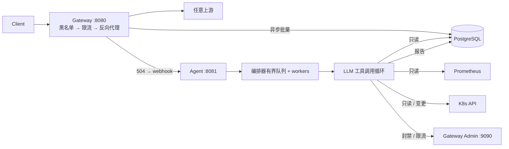

# Halon 项目阅读指南(How to Read This Project)

> 写给第一次接手本项目的人。目标:用最少的时间建立**正确的**理解,而不是通读每一行代码。
> 主线代码读懂约需 2 小时;加上动手实验约半天。

## 核心原则:先建立"地图",再看"细节"

不要从代码开始读,**从请求的生命周期开始读**。理解一个系统最快的路径是回答:
"一个请求进来,到出结果,中间经过了谁、变成了什么、失败时会发生什么?"

---

## 0. 一句话理解

**一个"会自己排查故障"的 K8s 网关。** 网关转发请求时一旦遇到上游超时(504),就把事件推给 Agent;Agent 驱动大模型调用工具(查流量日志库、Prometheus、K8s)排查,产出中文 Markdown 报告落库。



## 1. 先记住三个关键概念

读代码之前先把这三点装进脑子,后面很多"为什么这么写"都能自己解释:

1. **唯一契约 `TimeoutEvent`**([internal/incident/timeout.go](../internal/incident/timeout.go)):网关(发送方)与 Agent(接收方)只通过这个结构体耦合,改字段必须两边同改。网关不感知任何具体业务服务。
2. **操作级别**:`readonly` < `operator`(重启 Pod / 扩缩容 / 封禁 / 限流)< `full`(改镜像)。默认 `readonly`;`Registry` 在注册时按级别过滤工具,执行时再校验一次。
3. **两种运行模式**:`REDIS_URL` 为空 = 内存模式(网关与 Agent 均固定 1 副本);非空 = 共享模式(黑名单、限流、Agent 操作冷却外迁 Redis,可多副本)。熔断器/并发舱壁**有意保持 per-replica**;事件去重由数据库主键 `INSERT … ON CONFLICT DO NOTHING` 表决,内存 `Deduper` 只是快速路径。

## 2. 阅读路径(按顺序执行)

### 第 1 步:读文档,不看代码(约 30~60 分钟)

1. 根目录 [AGENTS.md](../AGENTS.md):约定与「当前已知边界」。
2. 两个核心模块文档:[modules/gateway.md](modules/gateway.md)、[modules/agent.md](modules/agent.md)。
3. 可选:[system-architecture.txt](system-architecture.txt) 了解立项动机——它是历史设计稿,部分设想未实现,以模块文档为准。

读的时候只记三件事:每个组件的**输入**、**输出**、**失败时会发生什么**。

### 第 2 步:按调用链读代码(约 2 小时)

**网关侧**(一个请求的一生):

| # | 文件 | 看什么 |
| --- | --- | --- |
| 1 | [cmd/gateway/main.go](../cmd/gateway/main.go) | 依赖装配:DB、日志/超时两条队列、可选 Redis、弹性策略、业务端口与管理端口、优雅退出顺序 |
| 2 | [server.go](../internal/gateway/server.go) | `NewHTTPHandler`:探针之外的一切走 `NoRoute` → 黑名单 → 限流 → `ProxyHandler`;`NewAdminHandler`:管理接口 |
| 3 | [proxy.go](../internal/gateway/proxy.go) | `ParseRoutes`(最长前缀优先)、分阶段超时、重试体缓冲与幂等判定;`upstreamErrorHandler` 把错误分类为 504/503/429/413/502 |
| 4 | [accesslog.go](../internal/gateway/accesslog.go) | **两条产品数据流的起点**:流量日志入队;若标记了上游超时则生成 `TimeoutEvent` 入队(队列满即丢弃 + 计数) |
| 5 | [notify.go](../internal/gateway/notify.go) | 超时事件 webhook 投递(最多 3 次、指数退避,4xx 不重试) |
| 6 | [resilience.go](../internal/gateway/resilience.go) | 按路由组合 failsafe-go 重试/熔断/舱壁(第二遍再细读) |
| 7 | [rules.go](../internal/gateway/rules.go) / [rules_redis.go](../internal/gateway/rules_redis.go)、[ratelimit.go](../internal/gateway/ratelimit.go) / [ratelimit_redis.go](../internal/gateway/ratelimit_redis.go) | 同一接口的内存 / Redis 两套实现,对照着读 |

**Agent 侧**(一个超时事件的一生):

| # | 文件 | 看什么 |
| --- | --- | --- |
| 1 | [cmd/agent/main.go](../cmd/agent/main.go) | 装配:LLM 客户端、工具注册(按级别)、K8s 客户端(集群内配置 → 回退本地 kubeconfig)、内存模式下的启动恢复 |
| 2 | [server.go](../internal/agent/server.go) | `POST /api/v1/incidents/timeout`:鉴权 → `Deduper` 快速去重 → `Submit`;报告查询接口 |
| 3 | [orchestrator.go](../internal/agent/orchestrator.go) + [suppress.go](../internal/agent/suppress.go) | 按路由抑制窗口(内存/Redis 双模式)→ `Claim`(数据库表决)→ 聚集延迟(`15s`)→ 有界队列(满则标记 failed + 短退避)→ worker `investigate` → 落库并刷新冷却 TTL;`RecoverUnfinished` 回收孤儿 |
| 4 | [loop.go](../internal/agent/loop.go) + [registry.go](../internal/agent/registry.go) | **Agent 核心仅约 100 行**:标准 tool-calling 循环、步数上限、工具输出两级截断(喂模型用小上限,落库用大上限)、Token 统计;系统提示词规定报告章节 |
| 5 | [tools/](../internal/agent/tools/) | `observability.go`(查日志库与 PromQL)、`kubernetes.go`(Pod/事件/Deployment 读写)、`cooldown.go`(变更操作冷却,内存或 Redis `SET NX PX`)。重点看护栏:命名空间白名单、副本上限、必填 `reason`、冷却 |

**技巧**:优先读接口与结构体,跳过实现细节。Go 里 interface 就是模块边界——`ReportStore`、`BlacklistStore`、`RateLimitBackend`、`CooldownStore`、`Model` 看懂了,模块间关系就清楚了。

### 第 3 步:跑起来,亲手"戳"它(约 1~2 小时)

需要一个 PostgreSQL;Agent 还需要 OpenAI 兼容的 API Key,以及可用的 kubeconfig(用于 K8s 工具)。完整环境变量见各模块文档的「配置」一节,以下是最小集:

```bash
# 演示上游(:8090,支持 ?delay=<ms> / ?status=<code> 故障注入)
make run-demo

# 网关
DATABASE_DSN=postgres://... ADMIN_TOKEN=<≥12位> \
ROUTES=/api/v1/users/=http://localhost:8090 UPSTREAM_TIMEOUT=3s \
AGENT_WEBHOOK_URL=http://localhost:8081/api/v1/incidents/timeout AGENT_WEBHOOK_TOKEN=<≥12位> \
HTTP_ADDR=:8080 make run-gateway

# Agent(INGEST_TOKEN 与网关的 AGENT_WEBHOOK_TOKEN 相同)
DATABASE_DSN=postgres://... INGEST_TOKEN=<同上> OPENAI_API_KEY=... OPENAI_MODEL=... \
GATEWAY_ADMIN_URL=http://localhost:9090 GATEWAY_ADMIN_TOKEN=<网关 ADMIN_TOKEN> \
make run-agent
```

然后依次做三个实验:

| 实验 | 操作 | 观察什么 |
| --- | --- | --- |
| 正常请求链路 | `curl localhost:8080/api/v1/users/1` | `base_logs` 的落库记录 → 理解日志链路 |
| 错误与慢请求 | `curl 'localhost:8080/api/v1/users/1?status=500'` | `error_body` 记录了请求/响应体 → 理解什么情况下保存请求/响应体 |
| 故障排查链路 | `curl 'localhost:8080/api/v1/users/1?delay=5000'` | 网关返回 504 → Agent 日志 → `curl -H "Authorization: Bearer $INGEST_TOKEN" localhost:8081/api/v1/incidents` 看报告 → 理解"超时 → webhook → LLM 排查 → 报告"全链路 |

另外可以看 `curl localhost:9090/metrics`,对照 [gateway.md 的指标清单](modules/gateway.md) 理解每个计数器在哪里递增。

### 第 4 步:把测试当文档读

测试就是"这个模块在各种场景下应该怎么表现"的活文档,想知道边界行为,看 `_test.go` 比看实现更快、更准:

| 想理解 | 看这里 |
| --- | --- |
| 代理、错误分类、重试/熔断 | `internal/gateway/server_test.go`、`resilience_test.go`(httptest 上游) |
| Redis 共享模式 | `rules_redis_test.go`、`ratelimit_redis_test.go`、`agent/suppress_test.go`、`tools/cooldown_test.go`(miniredis) |
| LLM 循环 | `internal/agent/loop_test.go`(`modelFunc` 桩) |
| 编排器 / 启动恢复 | `internal/agent/orchestrator_test.go` |
| 存储层 SQL | `internal/incident/store_test.go`(sqlmock) |
| K8s 工具护栏 | `internal/agent/tools/kubernetes_test.go`(fake clientset) |

### 第 5 步:改之前,先看提交历史

项目遵循 Conventional Commits,一次提交只做一件事:

```bash
git log --oneline                    # 先看全貌
git log -p -- internal/agent/tools   # 改某块逻辑前,看它的演化过程
```

设计层面的取舍记录在 [proposals/](proposals/) 下(弹性/观测、多副本共享状态、超时风暴按路由抑制),改相关模块前先读。

---

## 3. 读代码时值得留意的设计点(也是已知短板)

读到相应代码时可以留意下面几点,它们也是后续改进的候选:

- **工具输出会原样送入模型**:请求/响应体、Pod 日志都是不可信内容;operator 及以上级别存在提示注入风险。目前的防线是默认 `readonly`、命名空间白名单、副本上限和冷却。
- **`k8s_scale_deployment` 允许 `replicas=0`**。
- **共享模式下不做启动恢复**:需要租约机制才能安全回收悬挂的排查。
- **流量日志表暂无保留期或分区策略**。

## 4. 修改任何逻辑之前(强制检查项)

- [ ] 已读根目录 [AGENTS.md](../AGENTS.md) 的「当前已知边界」,确认改动不违反设计约束(例如:内存模式固定 1 副本;两端 `REDIS_URL` 必须同时配置或同时留空;熔断/舱壁是有意的 per-replica 语义;Agent 与网关使用独立的迁移版本表)。
- [ ] 已想清楚改动会波及哪个模块文档,并准备**在同一提交中**同步更新(见 [README.md](README.md) 的文档维护规则)。
- [ ] 已用 `git log -p -- <目标目录>` 看过目标代码的变更历史。
- [ ] 已确认新代码符合 AGENTS.md 的「代码约定」(配置集中走 `LoadConfig()`、错误响应统一结构、有界 channel、参数化 SQL 等)。
- [ ] 提交前已跑 `make test` 与 `make lint`。

## 5. 验收标准:什么时候算"弄懂了"

不是能复述架构,而是:

> **有人问你"我想给流量日志加上按天保留期清理,并把共享模式下的悬挂排查恢复也补上",你能立刻说出:**
> **要动哪几个文件、会触及哪条已知边界、哪几篇文档要跟着改。**

达到这个程度,就可以动手改逻辑了。

## 6. 阅读进度自检表

| 阶段 | 完成标志 |
| --- | --- |
| 概念 | 能说清 `TimeoutEvent`、操作级别、内存/共享模式分别是什么 |
| 第 1 步 | 能用三句话向别人说清网关和 Agent 各自干什么 |
| 第 2 步 | 能画出一条请求的完整调用链(网关侧 + Agent 侧) |
| 第 3 步 | 亲手在数据库里看到了日志和故障报告 |
| 第 4 步 | 知道每个核心模块的测试文件在哪、怎么跑 |
| 第 5 步 | 知道自己要改的那块代码最近三次提交都干了什么 |
